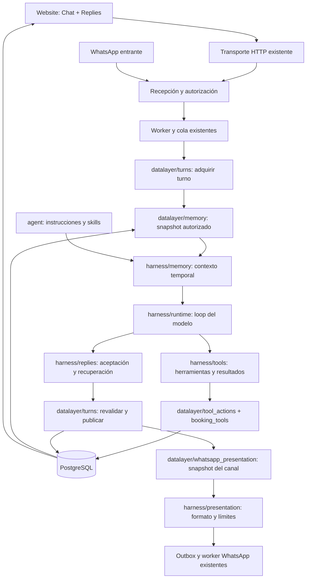

# Del bloque lógico al código

Los cuatro cambios de estructura están implementados. Las imágenes del visor conservan el diseño original; este mapa identifica los archivos actuales. La reorganización conserva instrucciones, contrato HTTP, tablas, migraciones e identificadores públicos.

Las flechas muestran responsabilidades, no todas las llamadas. El website recibe datos mediante HTTP; nunca consulta PostgreSQL directamente. La lectura y publicación usan transacciones cortas; las llamadas al modelo y a proveedores quedan fuera.

| Bloque | Dueño en código | Responsabilidad |
| --- | --- | --- |
| Memoria procedural | `backend/agent/instructions`, `skills`, `config.py` | Cargar instrucciones existentes sin cambios de contenido. |
| Fuentes persistentes de memoria | `backend/datalayer/memory.py` | Elegibilidad por entrega, alcance de origen, hechos, referencias y continuidad. Sin arranque de ejecución ni composición del prompt. |
| Working memory | `backend/harness/memory/context.py` | Construir contexto e historial temporal desde el snapshot. Sin consultas ni escrituras. |
| Ciclo LLM | `backend/harness/runtime.py` | Tiempo, reintentos, lotes de herramientas, terminación y una corrección de salida. |
| Herramientas del turno | `backend/harness/tools.py` | Ejecutar herramientas, proteger criterios, seleccionar fichas y conservar controles comprobados para recuperación. |
| Escrituras comerciales | `backend/datalayer/tool_actions.py`, `booking_tools.py` | Autorizar y ejecutar operaciones transaccionales. |
| Aceptación de respuesta | `backend/harness/replies/validation.py` | Validar respuesta completa contra hechos explícitos, sin ORM. |
| Adaptación transaccional | `backend/datalayer/replies.py` | Leer hechos actuales bajo bloqueo y aplicar aceptación y límites del canal. Proyectar controles vigentes al website. |
| Recuperación | `backend/harness/replies/recovery.py` | Componer una respuesta factual sin repetir operaciones comerciales. |
| Publicación | `backend/datalayer/turns.py` | Adquirir turno, registrar ejecución y guardar mensaje, presentación y continuidad atómicamente. Revalidar revisión, pausa e inventario. |
| Presentación por canal | `backend/harness/presentation` | Formato de fichas y WhatsApp, botones y límites, sin consultas ni red. |
| Snapshot de WhatsApp | `backend/datalayer/whatsapp_presentation.py` | Leer propuesta vigente de la conversación y suministrar datos al formato. |
| Entrega | `backend/datalayer/whatsapp.py`, `backend/worker/whatsapp.py` | Conservar recepción, deduplicación, outbox y HTTP existentes. |
| Sesión conversacional del website | `frontend/src/main-website/conversation/session.ts` | Restauración, envío, idempotencia, polling y descarte de respuestas tardías. |
| Adaptación al navegador | `frontend/src/main-website/conversation/useConversation.ts` | Conectar sesión con React, almacenamiento, HTTP y temporizadores. |
| Presentación del website | `frontend/src/main-website/conversation/Replies.tsx`, `components/Chat.tsx` | Renderizar bloques, controles y campo de escritura. No interpretar la conversación. |

## Dependencias y SOLID

- **Responsabilidad única:** lectura de memoria, composición, herramientas, aceptación, formato y entrega tienen dueños distintos.
- **Extensión:** las diferencias de canal permanecen en presentación; añadir un formato no requiere incorporar sus reglas al loop.
- **Sustitución:** el cliente del modelo ya admite sustitución. El ciclo del website usa transporte y temporizadores controlados en pruebas, con el mismo contrato que el navegador.
- **Segregación:** la validación recibe `ReplyFacts`; el formato recibe bloques y una instantánea de visita. Ninguno necesita conocer modelos ORM ni credenciales.
- **Dependencias:** las operaciones persistentes conservan bloqueos y autorización. No se añaden repositorios genéricos, clases por herramienta ni otra base de datos.

La segunda validación al publicar es deliberada: una propuesta puede perder vigencia mientras el modelo responde. La extracción no elimina esa comprobación.

## Verificación

- Backend: pruebas integradas existentes y `tests/test_reply_modules.py`, que verifica aceptación y formato sin consultas.
- Website: `pnpm test` comprueba restauración antes del interés, doble clic, borrador, reintentos idempotentes, polling, desmontaje y respuestas tardías.
- Estructura: Ruff, TypeScript, compilación de producción, comprobación Django y ausencia de migraciones nuevas.
- Las pruebas manuales del comportamiento conversacional siguen siendo necesarias; esta reorganización no acredita naturalidad adicional del modelo.

No hace falta reiniciar la plataforma para leer o revisar estos cambios. Las imágenes nuevas se aplican al recrear los contenedores; la sesión de pruebas que ya estaba ejecutándose conserva su versión hasta entonces.
