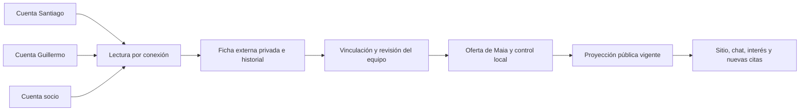

# EasyBroker: diseño técnico de importación y publicación

22 de noviembre de 2026. **Diseño técnico aprobado por Guillermo; implementación local validada y aceptación operativa pendiente.** Consolida las decisiones de EasyBroker Q1 y Q5–Q34 de la [entrevista](siguiente-etapa-easybroker-cuentas-contratos-gui-rc.md). Los modelos, importador, guardas y controles del CRM ya tienen código y pruebas. La [evidencia y los pendientes de aceptación](../testing/easybroker.md) distinguen pruebas locales, sandbox oficial y cuentas reales. Q2 sobre cuentas, contratos definitivos, rediseño general y AWS siguen como otros frentes. Este documento no declara RC lista.

**Continuidad:** las migraciones aditivas `0018`–`0020` se aplicaron a la base local, conservando los datos existentes. La publicación de importaciones permanece desactivada por defecto. No se conectaron cuentas reales ni se reconstruyeron los servicios desplegados. Se preservan los cambios previos de cierres, auditoría y Next.js; no se hicieron commits, pushes ni cambios de rama. Antes de activar, completar los pendientes de aceptación de la sección 12 y del recorrido de pruebas. Si el proveedor obliga a cambiar una regla aprobada, registrar el conflicto antes de sustituirla.

## 1. Resultado y alcance

Una misma Maia reúne inventario de varias cuentas autorizadas, por ejemplo Santiago, Guillermo y un socio. Actualiza cada hora, admite actualización manual y exige revisión inicial antes de publicar. La primera integración solo lee EasyBroker; no modifica anuncios, estados, contactos ni contratos externos.

Una baja, fallo, cierre local o desconexión puede impedir seguir ofreciendo una propiedad. **Ninguno borra su ficha ni su historial.** No se conservan archivos históricos de fotografías importadas. Un estado externo vendido/rentado no crea una operación realizada ni aporta un precio final.

La importación incluye inicialmente ofertas publicadas y disponibles. Guarda los registros incompletos o incompatibles para revisión, sin precios ficticios ni equivalencias forzadas. Venta y renta del mismo inmueble se representan con ofertas independientes, conforme al [ADR de identidad e historial](../adr/0002-inmueble-operaciones-historial.md).

## 2. Encaje con el sistema actual

Se conservan Django, PostgreSQL, Procrastinate, worker y frontend existentes. Los modelos nuevos mantienen el identificador Django `core`; no se añade una base, un microservicio ni otro planificador.

| Código actual comprobado | Consecuencia para la implementación |
| --- | --- |
| `datalayer/models.py`: `Property` es una oferta; `PhysicalProperty` es el inmueble. Precio obligatorio y moneda MXN/USD. | Mantener identidades y referencias; introducir una ficha externa previa a la oferta. No usar cero para datos ausentes. |
| `inventory.public_property()` expone precio, texto y varios JSON directamente; `managed_property()` la reutiliza. | Separar proyecciones pública y privada antes de introducir datos externos. |
| `public_inventory()` aplica publicación, retirada y exclusividad local. | Incorporar elegibilidad externa, revisión y caducidad a la misma consulta pública. |
| `turns.finish_turn`, `prospects.record_interest` y `appointments.validate_slot` tienen comprobaciones de `published` sin todas las condiciones. | Revalidar la guarda completa también al confirmar interés, cita y respuesta. |
| `property_records`, `PropertyEvent` y `ClosingRevision` conservan hechos y autores. | Reutilizar historia de oferta, añadir procedencia y distinguir proceso automático de persona. Nunca reescribir cierres confirmados. |
| `worker/tasks.py` y `dispatch.py` tienen trabajos periódicos y bloqueos por recurso. | Añadir trabajos por conexión en la misma cola, con prioridad inferior a conversaciones y citas. |
| `worker/google_calendar.py` cifra sus credenciales y evita HTTP dentro de transacciones. | Reutilizar el patrón, sin importar Calendar ni depender de su clave de cifrado. |

Estos hallazgos son puntos de partida, no cambios ya ejecutados. Una cuenta local de propietario no se crea por importar; tampoco se crea una captación o un contrato ficticio.

## 3. Separación de responsabilidades

EasyBroker gobierna los hechos del anuncio importado. Maia gobierna sus referencias, responsable local, revisión pública, exclusiones, prospectos, citas y operaciones realizadas. Esos datos locales no se sustituyen al actualizar el origen.

La vinculación de una oferta local previa, especialmente una captación con contrato, **no transfiere automáticamente su control a EasyBroker**. Se conserva como referencia del origen y se evitan duplicados públicos, sin sobrescribir captación, contrato ni datos locales. Solo las ofertas creadas como importadas reciben aplicación automática del origen. Una futura conversión de oferta local a gestionada por el origen queda fuera de esta versión.

## 4. Modelo de datos propuesto

Nombres técnicos orientativos; las invariantes son el contrato del diseño.

| Registro | Responsabilidad y campos relevantes |
| --- | --- |
| `EasyBrokerConnection` | UUID local estable, nombre del origen, entorno de pruebas/producción, asesor predeterminado, conexión habilitada, credencial cifrada, huella de credencial, generación de configuración, revisión y próximas fechas de ejecución. La huella no se entrega al cliente. |
| `EasyBrokerSyncRun` | Ejecución por conexión, generación capturada, secuencia, origen horario/manual, iniciador, estado, arrendamiento de ejecución, inicio/fin, checkpoint de fase/página/identificadores pendientes, contadores y códigos de error. Registra completitud, sin secretos ni respuestas HTTP completas. |
| `EasyBrokerListing` | Ficha externa identificada por conexión + `public_id`. Conserva hechos privados validados, estados observados, fechas de origen y comprobación local, operaciones con sus unidades originales, compatibilidad y revisión vigente. Existe aunque todavía no pueda crearse `Property`. |
| `EasyBrokerListingRevision` | Versiones inmutables de hechos comerciales recibidos y su correspondencia de campos. Excluye claves, datos de acceso, binarios y enlaces históricos de imágenes. No se crea una versión por cada comprobación sin cambios. |
| `EasyBrokerOfferLink` | Relación de una operación de una ficha con una oferta local, función principal/secundaria/referencia local, autor, fecha y motivo. Conserva relaciones anteriores; cambiar la principal exige acción humana. |
| `ImportedOfferPolicy` | Una por oferta importada: intención local de publicar, bloqueo manual, revisión de contenido/estructura, incidencias de compatibilidad y motivos de ocultación. Distingue caducidad recuperable, baja en origen y desconexión expresa. |
| `ImportedPublicTextRevision` | Título y descripción públicos revisados, revisión del origen que se examinó, restricciones de privacidad consideradas, autor/correo, fecha y motivo. Separados del texto bruto recibido. |

### Identidades y restricciones

- Unicidad en `(connection_id, public_id)`. Ni email, ni dirección, ni posición en una página identifican una ficha.
- Una conexión reutiliza su UUID durante una rotación válida de credencial. Reconectar no duplica registros ni restaura publicaciones automáticamente.
- Una misma credencial en el mismo entorno no crea dos conexiones activas. Una huella solo detecta claves idénticas; no demuestra que dos claves diferentes correspondan a organizaciones distintas o iguales.
- Una ficha puede tener venta y renta. Una operación soportada se reconoce por su tipo normalizado dentro de la ficha; importe, moneda y posición en el array no son su identidad. Más de una operación ambigua del mismo tipo queda pendiente de correspondencia, sin elegir arbitrariamente la primera.
- Como máximo una vinculación activa por ficha/operación y una fuente principal activa por oferta importada, con restricciones de base de datos. Las secundarias no proporcionan un reemplazo automático.
- Una ficha ya materializada mantiene su inmueble físico al añadir otra operación. Entre fichas diferentes, incluidas otras cuentas, la coincidencia requiere confirmación humana. No fusionar por dirección.
- Corregir una vinculación conserva los identificadores originales y su historia. No mover silenciosamente operaciones entre inmuebles ni alterar los acuerdos aceptados.

### Cambios mínimos en los modelos actuales

- `Property` incorpora procedencia local/importada, sin cambiar las referencias existentes. Las filas actuales se migran como locales.
- El precio y, cuando no se conocen, los datos monetarios privados deben poder quedar ausentes en una oferta importada de Precio por consultar. La validación del alta local conserva importe positivo y monedas actuales. No rellenar ausencias con cero o MXN.
- La publicación de un precio visible exige importe, moneda y unidad válidos. Un importe presente pero en moneda/unidad no soportada queda en la ficha externa, sin disfrazarlo como precio por consultar para evitar Q29.
- `PropertyEvent` distingue actor humano/proceso, conexión, ejecución, revisión externa e iniciador humano opcional. Los eventos previos conservan sus autores; no se reconstruye una autoría desconocida.
- El cierre conserva evidencia de la revisión externa empleada, además de sus datos actuales. La firma de revisión incluye los hechos relevantes y la fuente principal. Cambiar de fuente o de hechos invalida un resumen anterior; una comprobación sin cambios no lo invalida.
- El cierre confirmado permanece inmutable y la oferta cerrada no recibe sobrescrituras comerciales del importador. Las nuevas observaciones pueden seguir archivándose en la ficha externa. Una futura operación exige la acción local correspondiente, no la reaparición automática del anuncio.

No se usa `Property.details` como depósito de respuestas externas: hoy forma parte de la salida pública. La historia privada tampoco se envía al modelo conversacional.

## 5. Correspondencia de hechos

El contrato de normalización se versiona y distingue campo ausente, nulo explícito, valor válido y valor inválido. La semántica se comprueba contra documentación y muestras; un array o campo omitido en una respuesta parcial no autoriza a borrar datos.

| Dato recibido | Tratamiento |
| --- | --- |
| `public_id` y procedencia | Referencia externa estable, junto a la conexión. No usar email como clave. |
| Estado | Leer `/listing_statuses` ordinario. Solo `published` compatible y disponible habilita exposición. Vendido/rentado/reservado/suspendido/no publicado no confirma cierres locales. Estado desconocido requiere revisión. |
| Operaciones | Conservar tipo, importe, moneda, unidad y periodicidad del origen. Crear ofertas separadas de venta/renta cuando su correspondencia sea inequívoca. |
| Precio | Decimal exacto; validar precisión antes de materializar. Primera versión: venta con precio total y renta mensual verificable en MXN/USD. Sin convertir monedas, multiplicar precios por superficies ni convertir renta temporal a mensual. |
| Precio oculto | Guardar privadamente el importe si existe; salida pública `price=null` y Precio por consultar. Si el origen no entrega importe, sigue siendo desconocido. No publicar precio ni deducir compatibilidad con presupuesto. |
| Tipo/subtipo | Correspondencia explícita con el catálogo actual; conservar el símbolo/nombre original. Sin equivalencia segura, ficha pendiente. |
| Ubicación | Conservar dirección y coordenadas exactas solo en privado. Ubicación pública por estado, municipio y zona comprobados; no sustituir municipio ausente por otro nivel ni publicar coordenadas exactas mediante JSON o enlaces. |
| Texto | Título, descripción y otros textos recibidos son privados hasta revisión. La versión pública es independiente. No usar etiquetas, nombres de archivos o enlaces como alternativa no revisada. |
| Superficies | Terreno, construcción y superficie privativa separados. No deducir una superficie de otra. Un cero no prueba una superficie real; se conserva como dato recibido, sin inventar área utilizable. |
| Características | Conservar desconocidos; cero solo cuando es un valor explícito válido, por ejemplo estacionamientos. Medios baños separados, sin sumas no documentadas. Amenidades/conservación con correspondencia comprobada; conservar los originales no representables en privado. |
| Antigüedad | Distinguir año de construcción de edad en años. No guardar 2020 como 2020 años ni calcular una edad exacta sin la precisión necesaria. Preservar el año original y ampliarlo como hecho estructurado opcional si procede, con compatibilidad de revisiones antiguas. |
| Fotografías | Referencias vigentes completas, incluidas firmas/parámetros requeridos. Refrescar enlaces; no almacenar binarios ni un archivo histórico de URLs. Si fallan, retirar la imagen de la presentación, no la ficha. |
| Archivos y contactos | No importar automáticamente adjuntos privados, contratos ni carteras de clientes. El asesor local se asigna expresamente; no crear usuarios a partir de emails externos. |

Campos mínimos para exponer: operación soportada, tipo, ubicación pública mínima, datos monetarios coherentes o precio legítimamente oculto, responsable local y revisión pública aprobada. Los demás faltantes se señalan. El origen incompleto siempre conserva su ficha; no se fabrican `Property` inválidos para aparentar una importación completa.

Una retirada expresa de un dato cambia el hecho vigente a desconocido y conserva el anterior en historia. No se mantiene el valor anterior como actual por conveniencia.

Si un dato esencial nuevo no puede representarse en `Property`, la última materialización no se presenta como ficha vigente sin advertencia. El CRM distingue hechos actuales del origen de la última oferta válida aplicada. La proyección privada y `property_records.facts()` deben consultar ese estado en ofertas importadas abiertas: no recuperar como vigente un tipo, dirección o importe retirados mediante un fallback a la fila anterior. Si faltan mínimos de cierre, el asesor debe corregir el origen antes de confirmar. Las ofertas ya cerradas conservan su ficha/evidencia congeladas, separadas de observaciones externas posteriores.

La API ordinaria documenta `location.name`; no se importará por suposición el esquema `region/city/city_area` de partners. No separar por comas un nombre y dar por verificados municipio/colonia. Comprobar la correspondencia geográfica con el contrato ordinario y las muestras; cuando falte, la revisión humana establece una correspondencia explícita y trazable sin alterar el dato original. Hasta entonces no se publica una ubicación inventada. Es normalización del origen, no una segunda captación ni un nuevo contrato.

## 6. Publicación y privacidad como reglas comunes

`Property.published` puede conservarse como proyección operativa, pero **no es prueba suficiente de disponibilidad**. Para ofertas importadas, la guarda efectiva exige todas estas condiciones:

1. Intención local de publicar y revisión inicial aprobada.
2. Oferta sin cierre/retirada local y sin bloqueo manual.
3. Fuente principal y conexión activas, sin cambio de generación pendiente.
4. Última comprobación válida por oferta con antigüedad **menor de 24 horas**.
5. Estado externo publicado/disponible y datos compatibles.
6. Ausencia de revisiones bloqueantes de dirección, operación, vinculación o privacidad.
7. Texto público aprobado o una presentación estructurada previamente aprobada que no reutilice texto incompatible.

La guarda se evalúa con el reloj en listados, detalle, interés y reservas, y se revalida al confirmar acciones y antes de enviar fichas/respuestas demoradas. El mantenimiento periódico genera eventos y avisos, pero su retraso no extiende las 24 horas. En el límite exacto la oferta ya no se ofrece.

### Motivos independientes

No comprimir todos los motivos en un único estado que se sobrescriba con cada sondeo. Una oferta puede estar, a la vez, despublicada manualmente y caducada. Q23 solo permite recuperación automática si **la única causa** era la caducidad y se recuperan disponibilidad, compatibilidad y vigencia de aprobación.

| Transición | Efecto | Recuperación |
| --- | --- | --- |
| Primera importación | Ficha privada, sin publicación automática. | Revisión humana y selección. |
| Despublicación manual | Fuera de sitio/chat y nuevas citas; ficha e historia conservadas. | Acción humana, nunca el sondeo. |
| Baja externa confirmada | Ocultar y registrar motivo; mantener datos y citas existentes. | Disponibilidad en origen más revisión humana. |
| Primer fallo de actualización | Aviso interno, sin afirmar que se actualizó. Otras cuentas continúan. | Nueva comprobación válida por oferta. |
| Se cumplen 24 h sin comprobar | Ocultar por caducidad. | Automática solo bajo Q23; respeta todos los demás bloqueos. |
| Desconexión expresa | Ocultar inmediatamente las ofertas dependientes de esa fuente principal. | Reconexión y revisión humana. |
| Nueva dirección u operación | Revisar identidad/correspondencia; ocultar ofertas afectadas. | Revisión ligada a la revisión exacta del origen. |
| Nuevo texto | No sustituir la versión pública aprobada. | Revisión humana del texto nuevo. |
| Restricción de privacidad más fuerte | Suprimir el dato estructurado inmediatamente; ocultar si el texto vigente no está validado para esa restricción. | Revisión humana. |
| Cierre en Maia | Aplicar el cierre existente y congelar su evidencia. | Solo las acciones locales ya definidas, sin reapertura por el origen. |

### Proyección pública y precio por consultar

`public_property` entrega exclusivamente la versión pública. `managed_property` deja de construirse como una extensión de esa versión y obtiene una proyección privada explícita. Los contratos públicos se amplían con visibilidad del precio e importe/moneda públicos nulos cuando corresponda; se regeneran OpenAPI y tipos del frontend.

Los cambios afectan tarjetas, ficha, metadatos, JSON-LD, herramientas del agente, WhatsApp, respuestas de interés y sus formateadores. Ningún formateador convierte `null` a cero ni recupera el importe privado como fallback. Los filtros y ordenamientos usan un importe público calculado: los precios ocultos no participan en comparaciones, conteos por rango ni ordenación por su valor privado.

Las descripciones nuevas esperan revisión, como Q33. El texto anterior solo puede continuar si es compatible con los hechos/restricciones actuales; ante incertidumbre no se reutiliza como afirmación vigente. Puede usarse una presentación neutra basada en hechos estructurados ya aprobados si esa presentación sigue siendo válida. Si hay riesgo de revelar precio o ubicación restringidos, la oferta queda fuera hasta revisar. No se promete que una expresión regular o un modelo detecten todos los datos privados.

Los textos y coordenadas privados, `public_url` de origen, nombres de archivos, notas y tags no salen por rutas auxiliares ni se envían al modelo. Una URL pública de EasyBroker no sustituye la revisión de Maia. Las respuestas públicas deben ser dinámicas y no reutilizar cachés de precios/textos anteriores; el shell de interfaz sí puede conservar su caché. Las imágenes aprobadas son enlaces vigentes, no garantías de disponibilidad ni evidencia histórica.

## 7. Sincronización por conexión

### Ejecución y aislamiento

El planificador existente comprueba conexiones vencidas para su siguiente ejecución y encola una por cuenta cada hora, con distribución temporal para evitar picos. La actualización manual usa la misma ruta y devuelve un identificador de ejecución. Si ya hay una ejecución activa, informa de ella y registra la solicitud, sin duplicar todo el inventario ni atribuir al solicitante cambios de una ejecución anterior.

Un bloqueo de cola por conexión y una secuencia/arrendamiento en base de datos impiden aplicar dos ejecuciones superpuestas. Cada lote comprueba que la conexión sigue habilitada, mantiene su generación de credencial/configuración y corresponde a la ejecución vigente. Un trabajador antiguo no puede aplicar datos después de desconectar, rotar credenciales o recuperar un trabajo abandonado.

El barrido no ocupa un ejecutor durante toda la cuenta. Se divide en lotes reanudables, inicialmente con presupuesto máximo de 15 segundos por trabajo y tiempo de cada petición limitado por el presupuesto restante. Un límite global permite solo un lote de importación ejecutándose a la vez en el worker actual de cuatro ejecutores; la prioridad baja por sí sola no reservaría capacidad para conversaciones. Entre lotes se libera el ejecutor y se reparte trabajo entre cuentas. Los reintentos y la espera por límite de peticiones se reprograman, sin dormir dentro de un ejecutor. La prueba de carga medirá latencia del chat y duración del barrido para ajustar estos límites.

La cadencia horaria es el objetivo operativo aprobado. El volumen real debe procesarse dentro de ese presupuesto; si no alcanza, se observa retraso, se ajusta capacidad/límites y se vuelve a medir. No se oculta el retraso fingiendo éxito ni se solapan barridos sin control.

### Recorrido inicial propuesto

1. Capturar conexión, generación y ejecución en una transacción corta. Leer la credencial solo para el transporte servidor.
2. Recorrer estados ordinarios paginados, incluyendo estados de baja de registros conocidos. No filtrar solo publicados y perder bajas.
3. Para propiedades publicadas nuevas o conocidas, consultar detalle y validar hechos, privacidad y operaciones. La primera implementación prioriza el barrido completo comprobable; las optimizaciones incrementales requieren demostrar el contrato de fechas antes de activarlas.
4. Aplicar observaciones válidas por ficha en transacciones cortas; una ficha inválida no convierte las demás en bajas. Las negativas explícitas pueden ocultar una oferta aunque otra página falle después.
5. Preservar hechos nuevos mediante revisiones, actualizar las ofertas importadas elegibles, dejar pendientes las revisiones requeridas y refrescar sus referencias actuales de imágenes sin archivarlas.
6. Cerrar el resultado como completo/parcial/fallido, con contadores y motivos. La fecha de éxito de toda la conexión solo avanza si el recorrido correspondiente terminó correctamente.

La frescura se mide con la hora local de **comprobación válida de la oferta**, no con `updated_at` del proveedor ni con el inicio/fin general del trabajo. Renovarla requiere estado de disponibilidad válido y un detalle coherente y validado. Un fallo de detalle, una página incompleta o un éxito de otra propiedad no la renueva. Sondeos sin cambios no generan revisiones comerciales ni reinician la aprobación.

No hay HTTP dentro de transacciones. Tras la red, validar de nuevo generación y revisiones antes de escribir. Todas las rutas respetan el orden existente Captación → Oferta; al ampliar bloqueos, tomar primero conexión/ficha y después identidad/captación/oferta en orden determinista. Los cierres no adquieren después bloqueos de conexión/ficha: consultan su evidencia/versiones y mantienen la guarda local de cierre. Las políticas de oferta se modifican bajo el bloqueo de su oferta, evitando el ciclo política → oferta en otra ruta.

### Ausencias y errores

- La API no documenta una instantánea consistente entre páginas. Duplicados o movimientos se deduplican por identificador; nunca se deduce una baja solo por no aparecer en un barrido.
- Un 404 aislado no prueba eliminación ni cierre. Registrar inconsistencia y no renovar frescura hasta una observación válida. Una ficha no observada conserva su último dato; si no vuelve a comprobarse, sale por la regla de 24 h.
- 401 o credencial rechazada: marcar problema de autenticación y avisar; no insistir de forma agresiva ni reemplazar la clave por otra cuenta. Hasta corregir o desconectar, el inventario sigue la política de fallo/caducidad aprobada.
- 429, timeout o 5xx: reintentos limitados y espaciados, respetando `Retry-After` cuando sea válido, con una cuenta fallida sin bloquear la planificación de las demás. No marcar el intento como actualización exitosa.
- Comprobar esquema, tamaño y paginación; una respuesta 200 inválida no constituye éxito. No seguir indefinidamente páginas repetidas.
- Admitir `next_page=null` como final de recorrido, tal como muestran los ejemplos oficiales, aunque el esquema reutilizado no describa bien ese nulo. Validar los límites reales de página antes de fijarlos en el cliente.
- Comparar versiones observadas y rechazar respuestas anteriores a una revisión ya aplicada. Estados y detalles pueden cambiar entre peticiones: reconsultar ante contradicciones, sin prometer una instantánea atómica del proveedor.

El límite documentado es 20 solicitudes/s. Se propone empezar con un presupuesto global conservador de 2 solicitudes/s, con reparto entre conexiones y concurrencia acotada; se medirá con volumen real antes de ajustarlo. Esto es configuración técnica, no una garantía de caudal ni un límite comercial impuesto a Guillermo.

## 8. Seguridad, credenciales y autoría

- Administradores existentes conectan, cambian credenciales y desconectan. El equipo activo revisa ofertas y sigue trabajando sin un permiso nuevo de importación o cierre.
- La clave se cifra en base de datos con clave de configuración independiente de Calendar. Pérdida de esa clave significa reconectar las cuentas; el plan de respaldo/recuperación debe incluir su custodia separada. No se modifica el formato de Calendar por introducir EasyBroker.
- Los destinos de API son entornos predefinidos, no URLs arbitrarias introducidas por el usuario. No seguir redirecciones con la clave ni enlaces de paginación fuera del host/ruta permitidos. No consultar imágenes/documentos arbitrarios desde el servidor.
- Los campos de credencial son de escritura, no vuelven en respuestas, formularios, errores, historial ni logs. El estado visible es configurada/por corregir, con código de error no sensible.
- No se encontró un identificador estable de organización o `whoami` documentado en la API ordinaria. No suplirlo con emails, `/users` ni endpoints partners. Una sustitución de clave se valida como operación explícita: demostrar continuidad con identificadores comprobados cuando sea posible; si es ambigua, bloquear aplicación y exigir confirmar/corregir la cuenta, sin tratar silenciosamente otra organización como la misma fuente. Una nueva organización usa otra conexión.
- Todo cambio local comprueba revisión y sesión actual; doble clic/reintento usa una solicitud idempotente. Los trabajos automáticos registran proceso, cuenta, ejecución, fecha y diferencias. Las peticiones manuales conservan también iniciador y correo de sesión; no se finge que el titular externo hizo el cambio.

## 9. Cierres, citas, mensajes y datos ya entregados

Los cierres actuales siguen siendo acciones humanas sobre la oferta con precio y fecha finales. La importación nunca toca una `ClosingRevision` confirmada, cancela contratos locales, resuelve una búsqueda ni cambia consentimientos. La evidencia del cierre debe señalar la fuente/revisión de los datos copiados; una fuente retirada no borra esa evidencia.

Para citas nuevas, verificar la guarda de disponibilidad al buscar horario, al aceptar y antes de realizar una creación/reprogramación externa pendiente. Una oferta que ya no está disponible no admite otra reserva. Las citas existentes se conservan, con aviso interno por transición y cita, no por cada sondeo. Reutilizar los avisos con `notify_client=False`, sin convertirlos en mensajes automáticos al cliente.

Las respuestas del agente se construyen desde una proyección pública permitida. Antes de comprometer el turno se revalidan disponibilidad y revisión pública; antes de entregar WhatsApp se comprueba otra vez. Un mensaje pendiente con precio/texto ya privados se bloquea y se reconstruye desde datos vigentes; no basta borrar una tarjeta si el importe quedó escrito en el texto.

Los mensajes deben conservar referencias a ofertas y revisiones públicas utilizadas, para detectar cambios entre preparación y envío. La memoria que se entrega al modelo no reutiliza un precio o texto histórico como vigente: reproyectar tarjetas y filtrar el contexto relativo a ofertas restringidas. Si no puede sanearse con certeza una respuesta pendiente, regenerarla o derivarla a atención humana; no enviarla intacta.

Para tarjetas importadas persistidas en `Message.properties`, guardar referencias de oferta/revisión, sin URLs de fotografías ni copia del payload externo. Las imágenes vigentes se resuelven al leer o preparar una entrega; sus firmas no pasan al historial de fichas o mensajes. Al recuperar una conversación pública, revisar también `message.text`: si referencias/restricciones indican que puede contener datos ahora privados, sustituir ese texto por un aviso neutro y conservar el original solo para el equipo. El contexto del modelo excluye esos mensajes originales y recibe únicamente la información vigente permitida. No confiar solo en ocultar tarjetas ni en reconocer importes con expresiones regulares.

La revalidación final sucede antes de invocar el transporte externo. Un envío ya en curso puede coincidir con un cambio posterior de publicación; la base de datos y WhatsApp no comparten transacción. Registrar la revisión comprobada y el resultado; ante entrega incierta, aplicar el mecanismo existente de resultados desconocidos sin reenvío ciego. No prometer revocación de datos que ya aceptó el canal ni mantener transacciones SQL abiertas durante HTTP.

Lo ya entregado a un cliente no puede retirarse por cambiar un campo en la base. Se conserva la historia interna y se impide volver a difundir información ahora restringida. La API pública que recupera conversaciones no debe devolver tarjetas antiguas con datos hoy privados; la historia visible al cliente distingue referencias históricas de disponibilidad actual. No se promete borrar textos que ya recibió por WhatsApp.

## 10. Organización del código y contratos

| Módulo | Responsabilidad propuesta |
| --- | --- |
| `datalayer/easybroker/` | Validación/correspondencia de hechos, conexiones, vínculos, revisiones, reglas de importación y revisión. Interfaz pequeña para configurar, solicitar actualización, aplicar observaciones y revisar/vincular ofertas. |
| `worker/easybroker.py` | Transporte EasyBroker y orquestación del recorrido fuera de transacciones; recibe un cliente sustituible por fixtures para pruebas. |
| `worker/tasks.py`, `dispatch.py` | Planificación horaria, exclusión por conexión, mantenimiento de vigencia y ejecución de trabajos. |
| `datalayer/inventory.py` | Guarda/proyección común, búsqueda segura y proyección privada separada. La compatibilidad de importaciones no se reparte entre cada consumidor. |
| `api/easybroker.py` | Sesión/CSRF, permisos existentes, solicitudes y respuestas privadas. No HTTP remoto sincrónico dentro de una mutación larga. |
| `crm/components/` y `crm/lib/` | Conexiones, estado de ejecución, revisión de fichas y elección de fuente. Entradas del router permanecen en `frontend/src/app`. |

Las funciones del módulo reciben el contexto de actor, la revisión esperada y, donde hay una escritura reintentable, un identificador de solicitud. Devuelven estado/errores de dominio; no exponen requerimientos de paginación al frontend. El cliente HTTP real y las respuestas controladas de pruebas atraviesan la misma interfaz de importación.

Rutas privadas propuestas, versionadas por revisión del recurso:

- Administradores: listar/crear conexiones, reemplazar credencial, desconectar/reconectar y configurar responsable.
- Equipo: solicitar actualización, consultar ejecución y fichas conservadas; revisar texto y publicación; vincular explícitamente una oferta o seleccionar su principal.
- Respuesta de conexión: nombre, entorno, estado, responsable, fechas, contadores y revisión. Sin clave ni payload externo completo.
- Respuesta de ficha: hechos privados autorizados para el equipo, faltantes, vínculos, procedencia e historial; los registros aún no materializados son consultables desde importaciones.
- `409` para revisión obsoleta; `403` para sesión/permisos existentes insuficientes; errores de validación por campo; actualización en cola devuelve estado y ejecución. No repetir escrituras a ciegas desde la pantalla.

Contratos HTTP propuestos bajo `/api/crm/easybroker`:

| Método y ruta | Actor y resultado |
| --- | --- |
| `GET/POST /connections` | Administrador: configuración segura de conexiones, sin devolver claves. |
| `POST /connections/{id}/actions` | Administrador: configurar responsable, reemplazar credencial, desconectar o reconectar, con acción tipada, revisión e identificador de solicitud. |
| `POST /connections/{id}/sync` | Equipo: solicitar actualización, devolver ejecución o la que ya esté en curso. No espera el barrido. |
| `GET /runs/{id}` | Equipo: progreso/completitud, contadores y errores no sensibles. |
| `GET /imports` y `GET /imports/{id}` | Equipo: fichas conservadas, incluidas incompatibles, procedencia, vínculos e historial; paginación local. |
| `POST /imports/{id}/actions` | Equipo: revisión de texto/publicación, vinculación humana o selección de fuente, con revisión e idempotencia. Cada acción tiene su esquema de entrada, sin aceptar campos arbitrarios. |

La publicación/despublicación ordinaria de una oferta mantiene su ruta existente, que delega en la regla de importación cuando corresponda. Las respuestas privadas usan `private, no-store`; el frontend nunca consume la API de EasyBroker directamente.

La interfaz es funcional para operar la integración. El rediseño visual general sigue aplazado.

## 11. Secuencia de implementación aprobada y migraciones

1. **Base de datos y reglas:** agregar modelos/campos, proyecciones separadas, disponibilidad común, precio por consultar e historia de proceso. Preservar los datos locales y los contratos actuales, sin inferir importaciones, propietarios o cierres.
2. **Lectura y revisión:** cliente de solo lectura, recorridos por conexión, fichas privadas, correspondencia, revisión pública y controles en CRM. Desarrollo con fixtures y sandbox, sin cuentas reales aún.
3. **Coherencia integral:** revisiones y concurrencia, caducidad, conexión/reconexión, cierres, citas, contexto del agente y entregas pendientes. Activación pública de ofertas importadas solo después de pasar estas guardas.
4. **Aceptación operativa:** pruebas reales autorizadas de al menos dos cuentas, volumen y tiempo de ejecución medidos, privacidad y fallos aislados; registrar evidencia antes de declarar aceptada la integración en RC.

Puede utilizarse una bandera de activación durante el desarrollo para que los registros importados permanezcan privados. La implementación se entrega en cambios revisables; no hacer pública una fase que todavía permita saltarse la guarda desde otra ruta.

Las migraciones son aditivas, con `core`, tablas y referencias públicas conservadas. No se fabrican historiales anteriores ni correos desconocidos. Comparar antes/después huellas de inventario, captaciones, acuerdos, cierres, citas, conversaciones y seguimientos. La desactivación del importador no autoriza volver a un código antiguo que publique campos privados: rollback de exposición y compatibilidad de esquema se comprueban antes del despliegue.

## 12. Pruebas y criterios de aceptación

| Grupo | Casos que deben demostrar comportamiento |
| --- | --- |
| Varias cuentas | Dos orígenes independientes; misma clave duplicada; IDs repetidos entre páginas/cuentas; responsable por cuenta y excepción por oferta; un fallo no detiene al otro. |
| Identidad e idempotencia | Repetir importación/solicitud no duplica fichas, ofertas, revisiones o avisos. Vinculación humana preserva ofertas/contratos anteriores; principal única incluso con acciones concurrentes. |
| Operaciones y unidades | Venta/renta independientes del mismo inmueble; importe por m²/hectárea, renta temporal, moneda o tipo no representable quedan conservados pendientes; no multiplicar ni convertir; exactitud decimal. |
| Ausencias | Campos ausentes/nulos/inválidos diferenciados; ceros explícitos válidos; retirada de dato conserva versión anterior; 404, paginación móvil y barridos incompletos no crean bajas masivas. |
| Horarios y fallos | Última comprobación por oferta; exactamente 24 h; worker detenido; éxito parcial; recuperación solo por caducidad; baja o desconexión requieren revisión; lotes de varias cuentas sin agotar ejecutores de conversaciones. |
| Exclusiones | Despublicación manual, cierre y retirada sobreviven a reimportación, reconexión y recuperación. Una fuente secundaria no sustituye la principal. |
| Privacidad | Precio oculto fuera de JSON/HTML/metadata/chat/WhatsApp/memoria, filtros, ordenación y conteos por importe; recuperar una conversación después de restringir precio/texto no devuelve el original ni URLs históricas de fotos; coordenadas exactas nunca públicas; texto/captions/URLs sin aprobar no son fallback. |
| Revisión | Primera publicación explícita; texto nuevo espera revisión; cambios estructurales bloquean; una revisión obsoleta no aprueba otra versión; restricciones más fuertes invalidan lo necesario. |
| Red y concurrencia | Timeouts/401/429/5xx, `Retry-After`, JSON inválido, páginas repetidas, llamada interrumpida, dos workers, cambio de clave/desconexión durante petición, respuestas tardías y reintentos de transacción. |
| Fotos | URL íntegra y refrescada, sin archivo de fotos; enlace fallido muestra ficha sin imagen; títulos o URLs no revelan datos privados por campos alternativos. |
| Citas y mensajes | Baja entre búsqueda y reserva; envío pendiente tras ocultar precio/despublicar; conservación de citas y avisos internos deduplicados; no mensajes externos por importación. |
| Historia y cierre | Fecha/actor/procedencia y diferencias; proceso no se atribuye al dueño; iniciador manual preservado; cierre confirmado inmutable; reaparición no reabre ni reinicia seguimientos. |
| Seguridad | Sesión y CSRF; solo administradores gestionan secretos; equipo usa las ofertas sin permiso nuevo; cliente no elige autoría; ninguna credencial en respuestas/logs. |
| Regresión | Suite existente, tipos y compilación frontend, migraciones previstas y proxy real con la plataforma levantada. Operación local/propietarios y captación propia siguen sus reglas actuales. |

Pruebas de reloj, concurrencia y transportes controlados validan la política sin esperar un día ni alterar cuentas reales. El sandbox comprueba el contrato externo, pero no acredita permisos de la futura cuenta. Antes de aceptar en RC se comprueban dos cuentas reales y autorizadas, importación repetida, exclusiones, bajas, procedencia y aislamiento de fallos, sin crear bajas destructivas en sus anuncios reales.

## 13. Evidencia externa y límites pendientes de implementación

Fuentes verificadas en la [investigación](../research/easybroker-alcance-api-2026-11-22.md): [autenticación](https://dev.easybroker.com/docs/autenticaci%C3%B3n), [listado ordinario](https://dev.easybroker.com/reference/get_properties), [estados ordinarios](https://dev.easybroker.com/reference/get_listing-statuses), [detalle ordinario](https://dev.easybroker.com/reference/get_properties-property-id), [creación/esquema](https://dev.easybroker.com/reference/post_properties) y [tipos](https://dev.easybroker.com/reference/get_property-types).

- La API ordinaria está delimitada por la cuenta/organización autorizada, no por búsqueda de emails. No usar `/integration_partners/agencies` como un supuesto endpoint de identidad de la API normal.
- No hay garantía documentada de instantánea estable entre páginas ni prueba de borrado definitivo a partir de un 404. El diseño usa estados explícitos y caducidad comprobable, sin inventar esas garantías.
- Los límites reales de página, modalidades temporales, campos omitidos, correspondencias de catálogos y validación de continuidad de credencial se comprueban con contratos/fixtures y muestras. Lo no verificado queda pendiente de compatibilidad, sin publicar una interpretación errónea.
- EasyBroker puede devolver coordenadas almacenadas aunque su bandera prohíba mostrarlas. La restricción se impone en Maia, no se delega a la ausencia del campo.
- No se requiere una cuenta durante este diseño. Sin la prueba real de dos cuentas no se declara validada esa parte de RC.

Las comprobaciones técnicas anteriores no cambian las decisiones de producto. Si la evidencia obliga a cambiar una de ellas, se registra el conflicto y se vuelve a decidir antes de implementar una alternativa.
