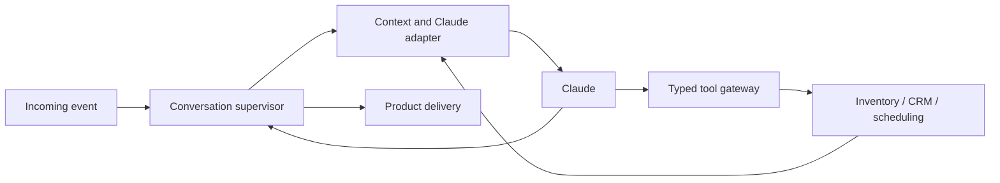

# Designing Maia's harness: an engineering learning guide

Date: October 8, 2026. Status: research synthesis and design proposals.
The small owned harness remains the primary candidate, not a proven runtime.
Nothing in this guide authorizes implementation or changes a working system.
The model baseline is Haiku 5.5 through the direct Anthropic API.

## Reading route and evidence

Start here for the architecture and tradeoffs, then read:

For the first design exercise, use the
[first-turn engineering contract](first-turn-engineering-contract.md), with
payload sketches and successful/corrected synthetic traces.

1. [Hermes source walkthrough](hermes-harness-engineering-walkthrough.md): how a
   real implementation arranges admission, requests, tools, retries and interrupts.
2. [Claude protocol research](claude-harness-protocol-research.md): the actual
   provider contract our loop must obey.
3. [Other harness patterns](harness-reference-patterns.md): small loops, context
   selection, durable graphs and long-running work without copying coding-agent
   requirements into a brokerage product.
4. [Observability research](harness-observability-research.md): correlating
   execution, business outcomes and delivery without permanent transcripts.

Primary sources and exact source links are in those reports. Source inspection
and documentation establish capabilities and constraints, not measured Maia
quality. No model calls, runtime installation or benchmarks were performed.
Existing Maia implementation and historical architecture are not the basis for
this design. Hermes was inspected at the live local clone's source revision,
not chosen as a deployment dependency.

## 1. The object we are designing

The harness is the application around inference. It provides a controlled
environment in which the model can ask questions, request tools and compose an
answer. It assembles evidence, obeys the provider protocol, controls execution,
records outcomes and handles interruption or failure.

For Maia, distinguish a conversational engine from its product supervisor.
The engine knows how to continue a model/tool exchange. The supervisor knows
whether this conversation is still under automatic attention and whether the
customer has corrected the request. Inventory, scheduling and delivery modules
own their respective facts and effects. These can be modules in one backend.

An agent framework does not remove these responsibilities. It implements a
subset and imposes interfaces for the rest. The choice is which responsibilities
we own directly, not whether a harness exists.

Anthropic's foundational agent article distinguishes model-directed tool usage
from predefined workflows. Its guidance supports starting with composable
mechanisms; its current page also warns that the original tooling discussion is
dated. Use the principle, not a 2024 vendor landscape, as the design evidence.
[Building effective agents](https://www.anthropic.com/engineering/building-effective-agents).

## 2. Four units that should not share one counter

| Unit | Meaning | Maia example |
| --- | --- | --- |
| Model round | One logical inference request and its response | Claude asks for inventory search |
| Conversational turn | Bounded work toward answering current customer input | Search, inspect details, then explain |
| Conversation | Customer interaction across turns, corrections and ownership changes | Returning to the previously selected house |
| Business workflow | Durable progress governed by business rules | A booking or the 28-day contact sequence |

The model's second call after receiving search results is a continuation, not a
retry. A second attempt after an overload response is a retry. A day-18 contact
is a new scheduled execution, not iteration 18 in an agent that stayed alive.
Separate limits, identifiers and metrics follow naturally from these definitions.

## 3. Walk a successful search through the system

Synthetic request: "Busco casa en venta en La Estancia, hasta cuatro millones,
con tres recámaras y dos baños."

1. Product intake resolves trusted brokerage/conversation identity and records
   the incoming event, avoiding duplicate processing.
2. The supervisor accepts work for the current request and ownership revision.
3. Context assembly selects role instructions, recent relevant exchanges, known
   customer facts and permitted tool definitions. It does not load the catalog.
4. Claude requests inventory search with structured criteria.
5. The gateway validates the name/schema and supplies trusted authority. Search
   enforces hard requirements and deterministic ranking against scoped stock.
6. The adapter returns the paired tool result while preserving the assistant's
   complete provider response, including continuation metadata.
7. Claude explains the returned options and real differences from the request.
8. The supervisor checks that the request and automatic ownership remain current.
9. Product delivery records and dispatches the completed reply through the channel.

The typed result identifies verified facts, ordered references, match differences
and source coverage. A successful empty search produces the agreed no-match
answer. Source outage and provider failure produce different outcomes.

Claude's client-tool protocol requires the application to execute the operation
and return correlated result blocks. A tool declaration is not code executed by
Anthropic and does not establish our authorization policy.
[Tool lifecycle](https://platform.claude.com/docs/en/agents-and-tools/tool-use/handle-tool-calls).

Observability spans these boundaries. The diagram shows logical responsibilities,
not proposed network services or implementation classes.

## 4. Tools are business interfaces, not generic remote control

The proposed sales surface is search inventory, read property, record stated
requirements/interest, offer slots, book an accepted option and request broker
attention. See [tool contracts](tool-contracts.md). Clear criteria are recorded
as customer-stated facts without another confirmation question; explicit human
requests pause automation with one acknowledgement and a CRM task.

A good tool interface compresses complexity. `offer_visit_slots` hides calendar
and property-window intersection; the model should not manually join calendars
or calculate visit eligibility. Search hides source reconciliation and ranking.

Strict schemas reduce malformed arguments, but a valid property reference can
still be unauthorized, withdrawn or stale. Local structural validation and
business checks are separate. A model-supplied `confirmed=true` cannot establish
customer acceptance; the booking command needs the current offered option and
acceptance evidence. Ambiguous acceptance should prompt clarification.

Tradeoff: many tiny technical tools create more rounds and give the model more
coordination work. Very broad tools hide errors and become difficult to explain.
Prefer cohesive business operations with explicit inputs and typed outcomes.
Do not expose arbitrary SQL, shell, HTTP or stock-editing powers to the customer
agent. The pilot does not require an MCP server merely to call internal functions.

## 5. Stop conditions are part of the design

The adapter must distinguish a complete reply, tool request, truncated response,
refusal, context exhaustion and transport failure. HTTP success does not imply a
useful reply. A maximum-token stop cannot be treated as a confirmed appointment.
[Stop reasons](https://platform.claude.com/docs/en/build-with-claude/handling-stop-reasons).

Proposed separate controls: model-round limit, individual request timeout,
overall turn deadline and bounded provider retry policy. Exact values need
evaluation; the accepted 10/20-second targets are not measured guarantees.
Detect repeated unsuccessful calls rather than allowing an infinite tool loop.

Read-only operations can later run concurrently where independent. A slot read
and booking write are dependent even if Claude returns both together. Start
with sequential tool execution for easier diagnosis; introduce proven read
parallelism when it materially helps latency. This is a proposal, not a settled
implementation choice.

## 6. Memory consists of different kinds of state

| State | Purpose | Authority |
| --- | --- | --- |
| Recent exchanges and shown-result order | Understand "la segunda" and corrections | What was said/shown, not current availability |
| CRM facts | Requirements, interests, visits and broker-confirmed milestones | Product facts with their source and status |
| Active provider continuation | Tool pairing and opaque model blocks | Required wire state, not customer/business memory |
| Pending business operations | Reconcile an accepted booking after failure | Recorded command and observed external outcome |

Seven-day recent-context retention is accepted. It does not mean sending seven
days of messages in every request or expiring an unresolved booking after seven
days. A context builder selects relevant state within an additional size bound.

Summaries are helpful but lossy. "The customer said they paid" must not become
"payment confirmed." Current listing data comes from tools; a previous reply
does not establish that the house is still available.

Haiku 5.5 continuation blocks have history-binding requirements. Preserve active
protocol segments intact. Arbitrarily deleting old messages, changing the initial
prompt or replacing tools while replaying signed thinking can invalidate them.
[Preserved thinking](https://platform.claude.com/docs/en/build-with-claude/preserved-thinking).

Proposed initial strategy: close complete tool cycles, then start deliberate new
protocol segments when role/context boundaries require it, reconstructing from
verified facts and bounded exchanges. Preserve displayed listing references.
Compare that with documented append-only/compaction mechanisms; do not implement
a generic rolling text window and assume it is protocol-safe.

## 7. Corrections and takeover are concurrency problems

Scenario: Maia is preparing Saturday options; the customer says "mejor domingo."
The old turn can finish late. Cancellation is useful, but the authoritative
gateway and delivery path must reject work based on the obsolete request.

Represent a current request revision and a current ownership revision. The
turn records the revisions it used. Before accepting consequential operations
and before dispatching a reply, the product checks them again. This is a proposed
mechanism for already accepted behavior, not a decided database schema.

Human attention through CRM changes who may speak automatically. It is different
from a human approving a tool and from one model handing reasoning to another.
During human attention, ingestion/internal reminders can continue while automatic
customer replies and follow-up pause. Resumption uses CRM facts; Maia does not
have access to the broker's personal WhatsApp messages by assumption.

Hermes distinguishes steering, redirecting and interruption. Its source also
shows why a timeout cannot establish that a tool's external work stopped.
[Exact source walkthrough](hermes-harness-engineering-walkthrough.md).

## 8. Retry reasoning, reconcile effects

Consider booking: Calendar receives a creation request, then the response is
lost. The operation outcome is unknown. A new model call may request the same
booking with a different tool-call ID. That is not permission to create another
appointment.

The product needs a stable business command/proposal identity and recorded
outcome, separate from provider request and tool IDs. It must reconcile using
the actual calendar adapter's supported lookup/idempotency mechanisms. Until
resolved, use factual pending wording. Cancellation cannot undo a dispatched
operation simply by stopping the model.

Provider overload can justify a bounded request retry. Invalid schema or revoked
credentials need a different response. SDK retries consume the same total
deadline; do not stack hidden retries under unbounded outer retries.
[Provider errors](https://platform.claude.com/docs/en/api/errors).

Restarting an interrupted read-only search is often simpler than checkpointing
every reasoning step. Recording consequential command state is essential even
if the conversational turn restarts. Choose recovery granularity based on what
can safely repeat, rather than persisting every token.

## 9. What to learn from Hermes

Borrow patterns: clear turn admission, distinct API retry and tool loops,
persist-before-dispatch ordering, matched tool results, explicit stop outcomes,
bounded context handling, interruption semantics and correlated lifecycle hooks.

Do not automatically inherit general-purpose shell/browser capabilities,
personal profile memory, provider rotation, skills, scheduler or broad global
configuration. Nor does using a small configured toolset make the installed
runtime an independently packaged minimal engine.

A fork saves selected implementation effort but creates ownership of dependency
closure, upstream fixes, protocol changes and regression testing. Source-reading
can inform an independent design without copying a runtime. Any later copying
requires explicit license/notice review at the selected revision.

## 10. Our loop, SDK runner or graph runtime?

| Candidate | Main benefit | Cost or remaining responsibility |
| --- | --- | --- |
| Official provider SDK plus narrow owned loop | Direct protocol visibility and precise admission hooks | We implement lifecycle, context, bounded execution and tracing |
| SDK tool runner | Less tool/result plumbing | Must prove conditional execution and recovery hooks are sufficient |
| Hermes | Broad existing conversational machinery | Integration, configuration scope, package coupling and defaults |
| Graph/checkpoint runtime | Explicit state and persistence machinery | Replay/node/version complexity; business effect reconciliation remains ours |
| Extracted fork | Selected upstream behavior | Maintained extraction and dependency compatibility |

Anthropic's current Tool Runner documentation recommends manual handling for
custom conditional execution and logging/HITL needs. It is a comparison option,
not a substitute for Maia's business contracts.
[Tool Runner](https://platform.claude.com/docs/en/agents-and-tools/tool-use/tool-runner).

LangGraph checkpoints and interrupts illustrate durable execution mechanisms,
but interrupted nodes can restart. Side effects still need idempotency and
reconciliation. A graph can describe execution without requiring a rigid
customer dialogue tree.
[LangGraph interrupts](https://docs.langchain.com/oss/python/langgraph/interrupts).

Recommendation remains the small owned loop candidate, using SDK transport and
complete responses initially. Evaluate it against Hermes with the same model
and equivalent product tools. No winner has been established by runtime tests.

## 11. Observability is an interface, not a final logging patch

Instrument one bounded turn and its linked queued work. Correlate the incoming
event, model request, tool call, durable operation, reply and delivery. Keep
conversation IDs separate from trace IDs and business command IDs.

Record versions, timings, stop reasons, typed outcomes, reported usage and
sanitized errors. Preserve evidence references rather than raw content by default.
Measure useful answers, not just first tokens. Model completion, booked visit,
provider acceptance and observed customer delivery are different outcomes.

OpenTelemetry's current agent conventions are Development; isolate mappings.
The model/tool conventions make content capture opt-in, which supports our
bounded-context rather than permanent-transcript design.
[GenAI conventions](https://github.com/open-telemetry/semantic-conventions-genai/blob/main/docs/gen-ai/gen-ai-spans.md).

Telemetry can explain what requests and results occurred; it does not expose
the model's complete internal reasoning or prove answer quality. Combine traces
with deterministic invariant checks and reviewed synthetic/live-authorized
evaluation. Full contract: [observability research](harness-observability-research.md).

## 12. Design patterns that earn their place

Use a provider Adapter to preserve Claude-specific mechanics, a role Strategy
for instructions/capabilities, business Commands for effects, and explicit
state transitions for turns/ownership. Dependencies point from the conversational
interface toward product contracts rather than privileged database internals.

An outbox-style delivery boundary separates committing a reply from remote
dispatch. Diagnostic events describe transitions but do not authorize them.
This is not a requirement for a generic event bus, microservices, an abstract
factory for every tool or a second LLM judging every output.

SOLID is useful when one responsibility can change without rewriting others:
ranking can evolve without replacing the loop; Claude protocol can change
without rewriting booking policy; presentation can change without duplicating
inventory search. Measure that independence through behavior contracts, not
through the number of interfaces or packages.

## 13. Small learning and later implementation slices

For each slice, first trace the expected events on paper; implementation remains
unauthorized until the design session ends explicitly.

1. One inquiry, one deterministic search tool, one grounded answer and trace.
2. Missing budget and explicit no-match outcomes, without unnecessary loops.
3. Property-detail lookup and preservation of shown-result references.
4. Correction arriving during work; obsolete reply cannot be dispatched.
5. CRM takeover/resumption while work is pending.
6. Offered slot and explicit acceptance, then confirmed booking.
7. Unknown booking outcome, restart and safe reconciliation.
8. Model failure producing the deterministic fallback and CRM task.
9. Scheduled follow-up as a fresh bounded run with generated wording.
10. Context boundary/role change with valid provider state and continuity.

For each, distinguish scenario correctness, conversational usefulness, useful
response time, observed attempts/usage and diagnostic completeness. Run exactly
the same business fixtures for candidate comparison, documenting unavoidable
provider differences. Do not score candidates using source-line count or fluent
answers alone.

The next discussion should trace a concrete search turn and its correction,
then choose the minimal context/recovery contracts. Remaining choices include
context size, protocol segmentation, execution limits and telemetry backend.
Those are proposals to settle through evidence, not hidden architecture decisions.
